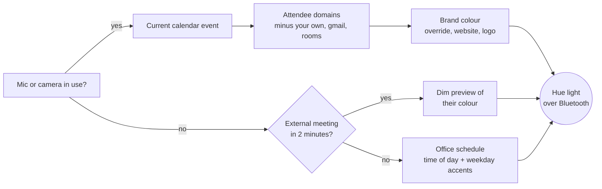

# HueLights

**Your Hue light shows who you're on a call with.**

HueLights is a tiny macOS background app that drives a Philips Hue **Bluetooth** light (no Hue Bridge, no cloud). When you join a call, it looks at the meeting in your calendar, works out which company you're talking to from the attendees' email domains, and turns the light behind you into that company's brand colour. The rest of the day it follows an office lighting schedule.



| Situation | Light |
|---|---|
| Call with an external company | That company's brand colour |
| Internal call (only your domain) | Your own company's colour |
| Call that isn't in the calendar | A fallback colour (purple by default) |
| 2 minutes before an external meeting | Dim preview of their colour |
| Office hours | Warm at arrival, cool and bright for focus, softer at lunch, warmer in the afternoon |
| After office hours | Off; weekends are left alone |

It only writes to the light when its decision changes, so if you adjust the light by hand, your change sticks until the next transition.

## Requirements

- macOS 14 or newer (tested on Apple Silicon)
- A Philips Hue light with Bluetooth (tested with a Hue Play). No bridge needed.
- Your calendar in the macOS Calendar app. For Google Calendar, add the account in System Settings → Internet Accounts.
- Xcode Command Line Tools (`xcode-select --install`) and Python 3.11+

## Install

1. **Pair the light with your Mac.** In the Hue app on your phone, open Settings → Voice assistants → Google Home or Amazon Alexa → **Make visible**. That opens a pairing window of a few minutes. Then close the Hue app, because the light only talks to one device at a time.
2. **Install:**
   ```bash
   git clone https://github.com/stepankaiser/huelights.git
   cd huelights
   ./install.sh
   ```
3. **Allow access when macOS asks.** HueLights needs **Calendar** access, and **Bluetooth** to reach the light. On first start it scans for the nearest Hue light and remembers it. macOS may also ask to pair with the light; accept.
4. **Edit your config** in `~/Library/Application Support/HueLights/config.json`. At minimum, set `my_domains` to your company's email domain. Changes are picked up within 2 minutes.

To check what it's doing, look at `~/Library/Application Support/HueLights/status.json` and `~/Library/Logs/HueLights.log`.

To uninstall: `./install.sh uninstall`.

## Configuration

See [`config.example.json`](config.example.json).

| Key | Meaning |
|---|---|
| `my_domains` | Your own email domains. Meetings with only these count as internal and get your own colour. |
| `brand_overrides` | Exact colours for companies where the automatic guess isn't right, e.g. `"coca-cola.com": "#f40009"` |
| `call.brightness` | Brightness during calls, in % |
| `call.no_calendar_colour` | Colour for calls that don't match a calendar event |
| `call.end_grace_seconds` | How long the mic or camera must be idle before the call counts as over (covers short drops) |
| `call.event_match_minutes` | How early or late around a meeting a call still counts as that meeting |
| `call.preview_minutes`, `call.preview_brightness` | The dim preview before an external meeting. Set `preview_minutes` to `0` to disable it. |
| `office_days` | Days the schedule runs (`mon` … `sun`) |
| `schedule` | `[time, state]` pairs. A state is `{"ct": kelvin, "bri": %}`, `{"color": "#hex", "bri": %}` or `null` (end of the day). |
| `day_accents` | Extra slots for specific weekdays, e.g. an amber Friday afternoon. An accent wins over a schedule slot at the same time. |
| `turn_off_after_office` | Switch the light off when the schedule ends |

## How it works

- **Light control:** [`hue.py`](hue.py) talks to the light's Bluetooth service directly, writing power, brightness, colour temperature and CIE xy colour. You can also use it on its own from Terminal: `python hue.py color '#ff6600'`.
- **Call detection:** [`native/callstate.c`](native/callstate.c) asks CoreAudio and CoreMediaIO whether any microphone or camera is in use by any app. These are the same flags behind the orange and green dots in the menu bar. It works with Meet, Zoom, Teams, Slack and anything else, and needs no microphone or camera permission.
- **Calendar:** [`lightd.py`](lightd.py) reads events through EventKit. It skips meetings you declined, plus free-mail addresses, meeting rooms and your own domains, then picks the most common remaining company domain.
- **Brand colours:** [`brand.py`](brand.py) checks your overrides first. Then it reads the company website's `theme-color` and web manifest, and finally takes the dominant vivid colour of the logo or favicon. If all of that fails, the company gets a stable colour derived from its name. Results are cached.
- **Why a `.app`?** macOS only lets an app use Bluetooth or Calendar if the app declares why it needs them. A bare Python process gets killed when it tries. [`install.sh`](install.sh) builds a minimal `HueLights.app` whose launcher ([`native/launcher.c`](native/launcher.c)) starts the Python daemon as a child process, so macOS treats the daemon's access as the app's. A LaunchAgent keeps it running from login.

## Privacy

- Your calendar never leaves the Mac. Only **company domains** are used outside it.
- To guess a colour, HueLights fetches that company's public homepage and logo, plus Google's favicon service. This happens once per domain, and the result is cached.
- If you'd rather not send those requests, put every company you care about in `brand_overrides`.

## Troubleshooting

- **"Insufficient Encryption" or the light doesn't respond:** the Mac isn't paired with the light yet. Make the light visible in the Hue app again (step 1), then restart HueLights: `launchctl kickstart -k gui/$UID/local.huelights`.
- **Light changes fail while the Hue app is open on your phone:** the light accepts only one connection at a time. HueLights retries every 20 seconds.
- **Every call is purple:** the calendar isn't connected, or the call doesn't overlap a meeting. The log shows which calendars and how many meetings HueLights sees at startup.
- **A Python crash report mentioning `NSBluetoothAlwaysUsageDescription`:** something ran the Bluetooth code outside `HueLights.app` or Terminal. Run `hue.py` from Terminal.app.

## Credits

The Hue Bluetooth service layout comes from community reverse-engineering, notably [HueBLE](https://github.com/flip-dots/HueBLE) and [libhueble](https://github.com/alexhorn/libhueble). This project isn't affiliated with Philips Hue / Signify.

## License

[MIT](LICENSE)
